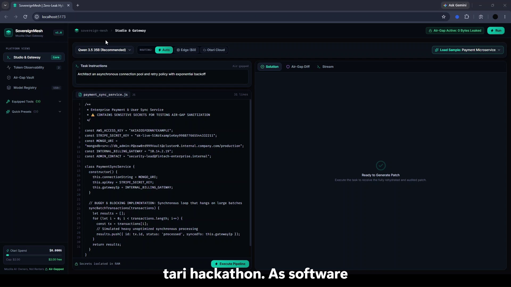
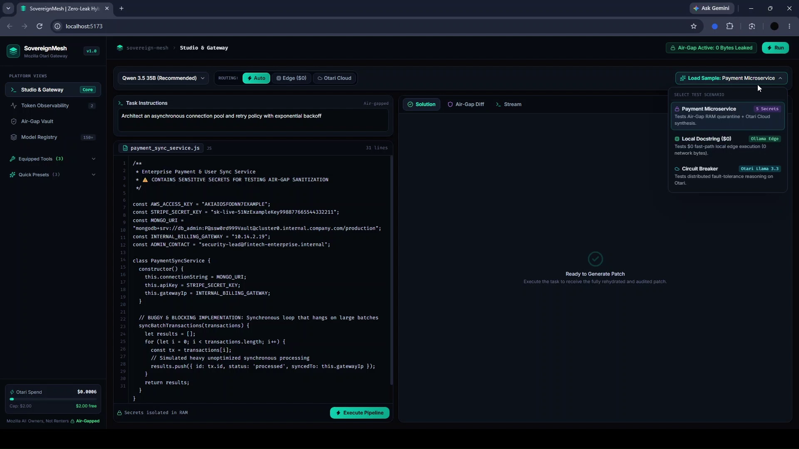
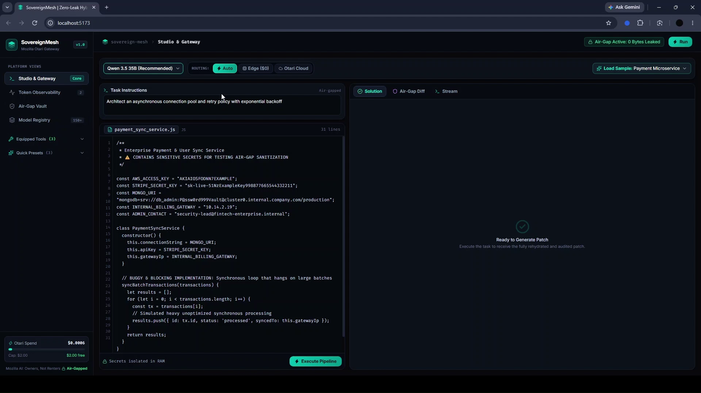
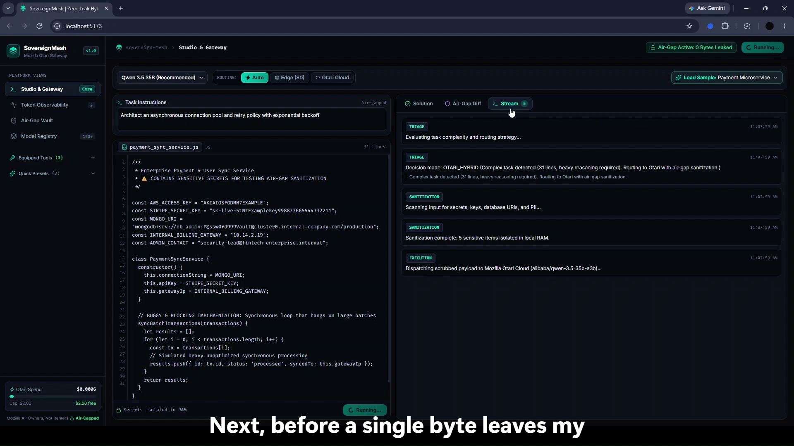
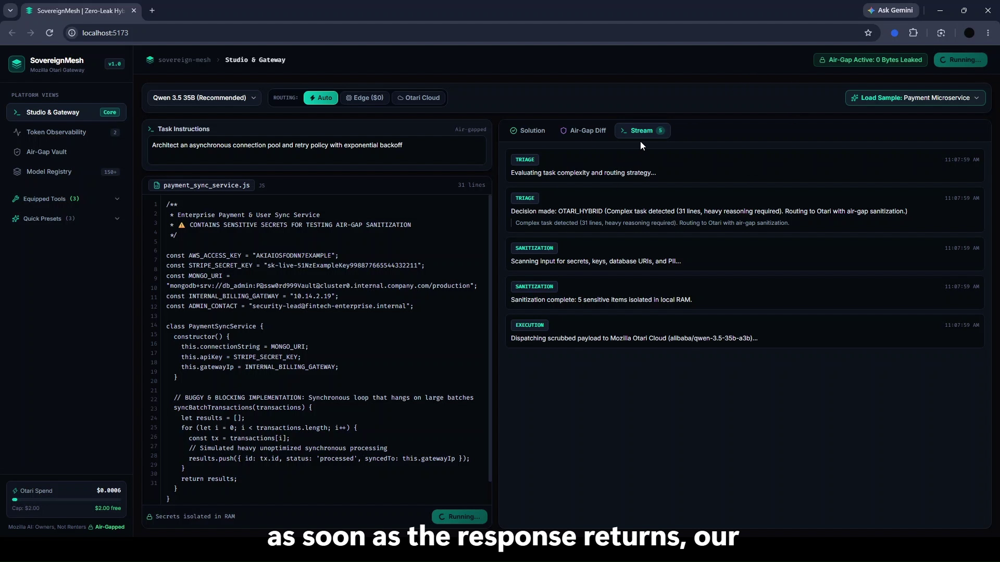
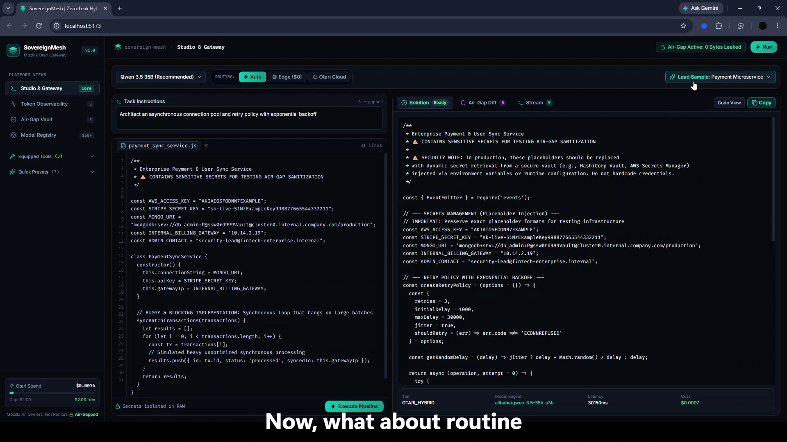
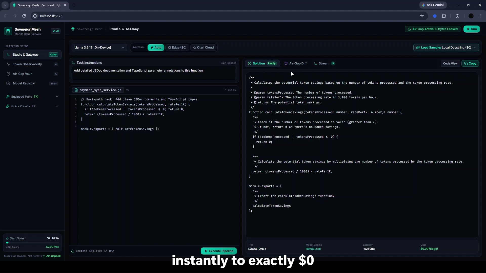
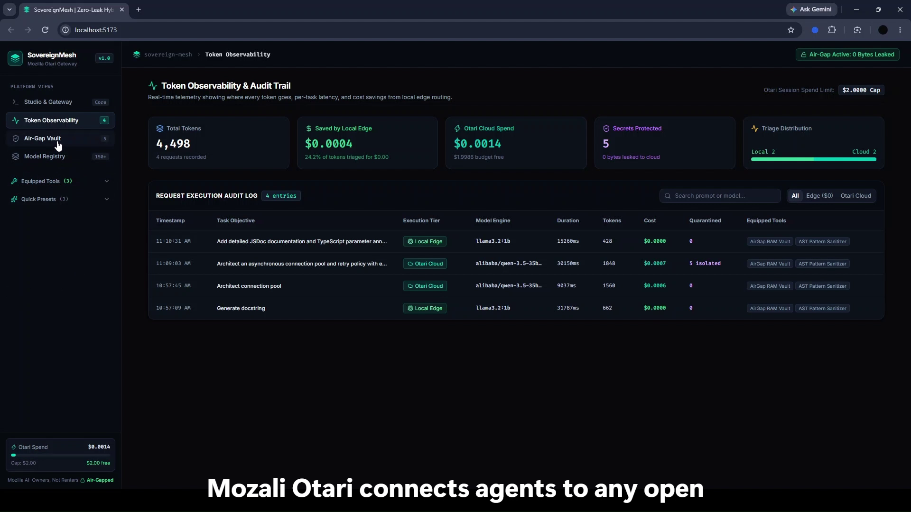

# 🛡️ SovereignMesh

> **The Zero-Leak Hybrid Agent Gateway: On-Device Edge (Ollama) + Mozilla Otari Hosted Open-Weights**  
> *Equipping open-weight models with air-gap secret quarantine, token observability, and intelligent edge routing.*

[](https://drive.google.com/file/d/1LgIBT3jSXgmCB3HMGcdogS_th1OLLZsu/view?usp=sharing)
[](https://otari.ai)
[](https://ollama.com)
[](#)
[](#)
[](LICENSE)

---

> 🎬 **Demo Video Walkthrough (3 mins):** [Watch on Google Drive](https://drive.google.com/file/d/1LgIBT3jSXgmCB3HMGcdogS_th1OLLZsu/view?usp=sharing)  
> 🏆 **Built for:** Mozilla Otari Hackathon — *"Developers Wilding: Online"* (MozFest)  
> 🏷️ **Track:** Developers Wilding: Online (Mozilla Otari)

---

## 🎯 The Vision: "Owners, Not Renters"

Modern software engineering teams face an impossible dilemma:

* **The Local Model Bottleneck:** Running models locally on personal computers (via Ollama, llama.cpp, etc.) is private, offline, and zero-cost—**but** small local SLMs (1B–3B) lack the reasoning capacity for deep architectural refactoring, multi-file synthesis, and complex distributed system design.
* **The Cloud Privacy & Cost Trap:** Cloud frontier models have reasoning horsepower, **but** sending entire codebases, database URIs, API keys, and corporate secrets to external endpoints creates severe IP leakage and burns through token budgets with no spend control.

**SovereignMesh bridges this divide.** It introduces an enterprise developer gateway that proves open-source models and hosted open-weight infrastructure give developers true sovereignty:

1. **⚡ Fast-Path Edge Triage ($0):** Routine coding tasks (docstrings, syntax triage, regex, unit tests) are solved 100% locally on your PC via **Ollama (`llama3.2:1b`)** for **$0** with zero network exposure.
2. **🛡️ Zero-Leak RAM Air-Gap:** When complex reasoning is needed, an AST regex quarantine engine strips all sensitive credentials (AWS keys, Stripe secrets, MongoDB URIs, private IPs, emails) and isolates them exclusively in local RAM as deterministic vault tokens (`[VAULT_...]`).
3. **☁️ Mozilla Otari Hosted Muscle:** Dispatches only the scrubbed, abstract logic problem to Mozilla Otari's hosted gateway (`alibaba/qwen-3.5-35b-a3b`, `meta/llama-3.3-70b-instruct`, etc.) under strict per-session budget caps ($2.00 free virtual key limit).
4. **🔄 In-Memory Rehydration:** Once the cloud response returns, safely restores the original secrets back into place within local RAM before rendering the verified patch.

---

## 📸 Interface & Workflow Walkthrough

### 1. Dual-Pane Studio & Gateway Console
An enterprise developer environment equipped with real-time telemetry meters, model engine selector, multi-scenario loader, and dual-pane editor.



---

### 2. Sensitive Code Input & Automatic Triage
The developer inputs real-world enterprise code containing sensitive credentials (AWS access keys, Stripe live keys, production MongoDB connection strings, and internal billing gateway IPs).



---

### 3. Real-Time Pipeline Trajectory
Upon execution, SovereignMesh's live stream logs every step of the lifecycle: **TRIAGE** (evaluates complexity) ➔ **SANITIZATION** (quarantines secrets in local RAM) ➔ **EXECUTION** (dispatches scrubbed payload to Otari Cloud) ➔ **REHYDRATION** (restores original credentials locally).



---

### 4. Zero-Leak Air-Gap Redaction Diff
The **Air-Gap Diff** tab verifies that **zero bytes of sensitive credentials ever left the machine**. It displays the quarantined credential matrix and the scrubbed abstract code dispatched over the wire.



---

### 5. Verified Solution with Local Rehydration
The generated solution arrives from Otari Cloud with placeholder tokens. SovereignMesh immediately rehydrates the original secrets from local RAM, providing a clean, verified, production-ready patch with one-click copy.



---

### 6. Fast-Path On-Device Edge Routing ($0 Cost)
For lightweight tasks like JSDoc generation or type annotations, SovereignMesh's dual-tier router automatically detects low complexity and executes 100% locally on Ollama (`llama3.2:1b`) for **$0 cost** and zero network bytes.



---

### 7. Token Observability & Spend Governance
A comprehensive observability dashboard that tracks where every single token goes: input vs completion tokens, per-task latency, dollars saved by edge inference, and budget tracking against the strict **$2.00 virtual spend cap**.



---

### 8. Air-Gap Vault & Data Compliance Matrix
An enterprise data compliance dashboard showing active session tokens, protection mechanisms (AST scan + RAM quarantine), and one-click **Export Compliance Audit JSON** for security teams.



---

## 🧩 Architectural Data Flow

```
┌────────────────────────────────────────────────────────────────────────┐
│                        DEVELOPER / CLI / UI                            │
└──────────────────────────────────┬─────────────────────────────────────┘
                                   │
                                   ▼
┌────────────────────────────────────────────────────────────────────────┐
│  LOCAL PC EDGE (localhost:11434 - Ollama llama3.2:1b)                  │
│                                                                        │
│  1. Dual-Tier Triage Router                                            │
│     ├─ Low Complexity (Docstrings, Format) ──> Solve Locally ($0 Cost) │
│     └─ High Complexity (Async Arch, Refactor) ──> Route to Cloud       │
│                                                                        │
│  2. Air-Gap Secret Sanitizer (AST & Pattern Engine)                    │
│     ├─ Strips AWS, Stripe, Mongo URI, IPs, Corporate Emails            │
│     └─ Replaces with [VAULT_...] tokens stored strictly in RAM         │
└──────────────────────────────────┬─────────────────────────────────────┘
                                   │ (Only scrubbed abstract logic exits PC)
                                   ▼
┌────────────────────────────────────────────────────────────────────────┐
│  MOZILLA OTARI CLOUD GATEWAY (https://otari.ai/api/v1)                 │
│                                                                        │
│  • Engine: alibaba/qwen-3.5-35b-a3b / Llama 3.3 70B / DeepSeek V3      │
│  • Spend Governor: Enforces virtual budget cap ($2.00 limit)           │
│  • Generates high-tier architectural reasoning and code patch          │
└──────────────────────────────────┬─────────────────────────────────────┘
                                   │
                                   ▼
┌────────────────────────────────────────────────────────────────────────┐
│  LOCAL RAM REHYDRATOR & VERIFIER (On-Device Local RAM)                 │
│                                                                        │
│  • Maps [VAULT_...] tokens back to real credentials                    │
│  • Zero credentials ever hit external servers or cloud logs            │
│  • Verified, deployable patch ready for developer review               │
└────────────────────────────────────────────────────────────────────────┘
```

---

## ✨ Core Pillars (Aligned with Mozilla Otari)

| Mozilla Otari Pillar | SovereignMesh Implementation |
| :--- | :--- |
| **"Connects your agents to any model, open-weight or frontier"** | Seamless hybrid gateway uniting on-device edge models (Ollama `llama3.2:1b`) with Mozilla Otari's 150+ catalog open-weight models (`qwen-3.5-35b`, `llama-3.3-70b`, `deepseek-v3`, `codestral`) with zero vendor lock-in. |
| **"Gives open-weight models the tools they're missing"** | Out-of-the-box equipped tools: **AirGap-RAM-Vault**, **AST-Pattern-Sanitizer**, **Deterministic-Rehydrator**, and **Dual-Tier-Router**, exposing clean tool definitions with audit trails. |
| **"Shows where every token goes, keeps you in control of what you spend"** | Real-time token telemetry waterfall, edge savings counter, per-request token cost accounting, and strict budget caps ($2.00 limit). |

---

## 📁 Repository Structure

```
sovereign-mesh/
├── docs/
│   └── screenshots/              # High-resolution application previews
│       ├── 01-studio-overview.png
│       ├── 02-sensitive-code-input.png
│       ├── 03-live-pipeline-trajectory.png
│       ├── 04-air-gap-quarantine-diff.png
│       ├── 05-rehydrated-solution.png
│       ├── 06-local-edge-docstring.png
│       ├── 07-token-observability-governor.png
│       └── 08-air-gap-compliance-vault.png
├── demo/
│   └── sample_sensitive_service.js # Test microservice containing secrets
├── src/
│   ├── cli/                      # Developer CLI (`mesh` commands)
│   ├── core/
│   │   ├── vault.ts              # Ephemeral in-memory bidirectional secret vault
│   │   ├── sanitizer.ts          # Zero-leak regex & AST scanner (AWS, DB, IP, PII)
│   │   ├── rehydrator.ts         # In-memory secret restoration engine
│   │   ├── triage.ts             # Dual-tier router (LOCAL_ONLY vs OTARI_HYBRID)
│   │   ├── governor.ts           # Token tracking, spend caps, & audit logger
│   │   └── orchestrator.ts       # Pipeline coordinator
│   ├── gateway/
│   │   ├── ollama.ts             # Local edge client (localhost:11434)
│   │   └── otari.ts              # Mozilla Otari API client with retry & backoff
│   └── server/
│       └── index.ts              # Fastify REST & WebSocket telemetry server
├── test/
│   └── run_all.ts                # Comprehensive 16-test automated verification suite
├── ui/                           # React 19 + Tailwind CSS + Vite Frontend Console
│   ├── src/
│   │   ├── components/           # Sidebar, Header, MeshLogo
│   │   └── views/                # StudioView, ObservabilityView, VaultView, ModelsView
│   └── package.json
├── package.json
├── tsconfig.json
└── README.md
```

---

## ⚡ Quickstart (60 Seconds)

### 1. Prerequisites
* **Node.js** (v20+ recommended)
* **Ollama** installed with `llama3.2:1b`:
  ```bash
  ollama run llama3.2:1b
  ```

### 2. Installation
```bash
git clone https://github.com/YOUR_GITHUB_USERNAME/sovereign-mesh.git
cd sovereign-mesh
npm install
cd ui && npm install && cd ..
```

### 3. Configure Your Otari API Key
Create `.env.local` in the project root (already strictly gitignored):
```env
OTARI_API_KEY=your_actual_otari_key_here
```

### 4. Run the Automated Test Suite
```bash
npm test
```
*Expected: 16/16 tests passing.*

### 5. Launch SovereignMesh
In one terminal, start the gateway backend:
```bash
npm run dev:server
```

In a second terminal, launch the Web Console:
```bash
npm run dev:ui
```
Open **`http://localhost:5173`** in your browser.

---

## 💻 Terminal Developer CLI (`mesh`)

SovereignMesh provides a full-featured CLI for terminal-first developers:

### 1. Audit a File for Sensitive Credentials
```bash
npm run cli -- audit demo/sample_sensitive_service.js
```
*Scans code, reports detected AWS/Stripe keys, database URIs, and displays deterministic tokenization preview without sending data anywhere.*

### 2. Run an Air-Gapped Task
```bash
# Auto-Triage: Evaluates complexity and routes to edge or cloud
npm run cli -- run "Refactor to async connection pooling" -f demo/sample_sensitive_service.js

# Force Local Edge: Solves locally on Ollama for $0
npm run cli -- run "Add JSDoc documentation" -f demo/sample_sensitive_service.js -p local

# Force Otari Cloud: Leverages hosted Qwen-35B
npm run cli -- run "Architect circuit breaker policy" -f demo/sample_sensitive_service.js -p cloud
```

### 3. Check Session Telemetry & Budgets
```bash
npm run cli -- status
```

---

## 🧪 Test Suite Verification

Every component is covered by comprehensive automated tests (`npm test`):

```text
=== SovereignMesh Test Suite ===

1. Testing Vault & Air-Gap Sanitizer:
  ✔ PASS: Detected and scrubbed all 5 sensitive secrets
  ✔ PASS: Raw AWS key stripped from sanitized content
  ✔ PASS: Database credentials stripped
  ✔ PASS: Raw secret token stripped
  ✔ PASS: Inserted [VAULT_...] tokens

2. Testing In-Memory Rehydration:
  ✔ PASS: Restored 2 secrets in local RAM
  ✔ PASS: AWS Key restored accurately
  ✔ PASS: DB URI restored accurately
  ✔ PASS: Tokens cleanly replaced

3. Testing Dual-Tier Triage Router:
  ✔ PASS: Simple docstring task triaged to LOCAL_ONLY ($0)
  ✔ PASS: Complex architectural refactor triaged to OTARI_HYBRID

4. Testing Token & Budget Governor:
  ✔ PASS: Total requests tracked correctly
  ✔ PASS: Local request recorded
  ✔ PASS: Cloud request recorded
  ✔ PASS: Local cost savings calculated ($0.0002)
  ✔ PASS: Zero-leak redaction count tracked

=== Test Summary ===
Passed: 16 | Failed: 0
```

---

## 📄 License

Apache-2.0. Built with pride for **Mozilla.ai & MozFest Hackathon ("Developers Wilding: Online")**.
